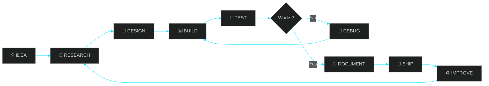
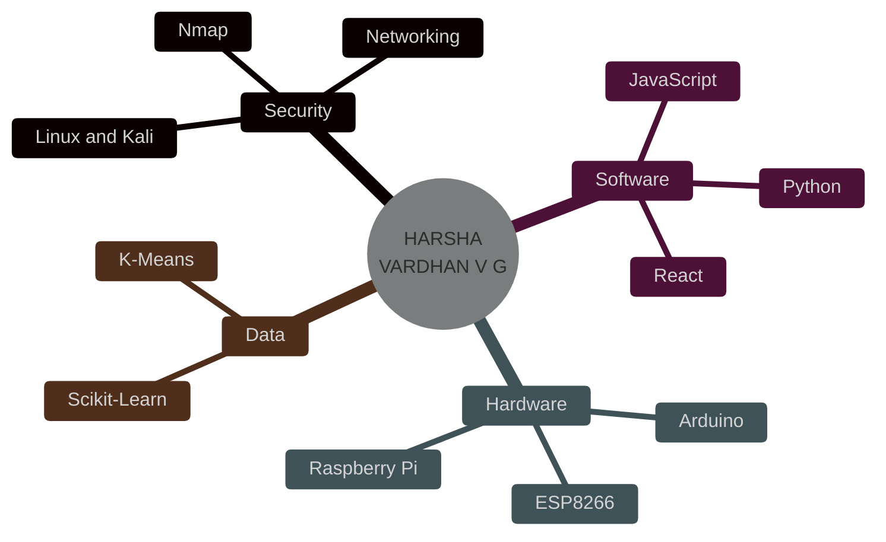

<div align="center">


<br/>


<br/><br/>

[](https://github.com/HARSHA-TKD)
[](https://github.com/HARSHA-TKD?tab=repositories)


<br/>

**[IDENTITY](#01--identity)** · **[ARSENAL](#02--technical-arsenal)** · **[MISSIONS](#03--missions)** · **[LAB](#04--hardware-lab)** · **[METHOD](#05--method)** · **[TELEMETRY](#06--telemetry)** · **[PRINCIPLES](#07--operating-principles)**

</div>

---

## 01 // Identity

```text
╔══════════════════════════════════════════════════════════╗
║  NAME        :  Harsha Vardhan V G                       ║
║  HANDLE      :  HARSHA-TKD                               ║
║  FIELDS      :  Cybersecurity · Software · IoT · Data    ║
║  OS          :  Kali Linux / Windows                     ║
║  OBSESSION   :  Understanding how systems actually work  ║
║  MOTTO       :  Learn. Build. Experiment.                ║
║  STATUS      :  ● ONLINE — continuously evolving         ║
╚══════════════════════════════════════════════════════════╝
```

I work where **code meets circuits and security meets curiosity**. Some days that means scanning a network and writing the report, other days it means wiring sensors to a Raspberry Pi and teaching it to see.

> **I don't just learn technology. I find out what it can be made to do.**

---

## 02 // Technical Arsenal

<div align="center">


<br/><br/>


</div>

---

## 03 // Missions

| # | Mission | Objective | Tech |
|:-:|:--|:--|:--|
| 01 | **Network Scan Report Generator** | Run Nmap scans and turn raw output into structured reports | `Python` `Nmap` |
| 02 | **Phishing Email Identifier** | Examine email indicators and flag suspicious messages | `Python` |
| 03 | **Password Strength Checker** | Evaluate password characteristics and give feedback | `Python` |
| 04 | **Caesar Cipher Tool** | Command-line encryption and decryption | `Python` |
| 05 | **Hangman Ultimate** | Terminal game with game logic and scoring | `Python` |
| 06 | **K-Means Clustering: Loan Management** | Explore patterns and groupings in loan data | `Python` `Scikit-Learn` |

### ⚡ Flagship Mission: TERRA-X

<table>
<tr>
<td width="62%" valign="top">

**Classification:** IoT · Robotics · Computer Vision

An experimental prototype that combines microcontrollers, sensors, wireless control, and live computer vision in one machine.

- Servo-based camera system with live video
- OpenCV vision pipeline
- Temperature and humidity sensing
- Ultrasonic distance sensing
- Wireless control from a mobile device

</td>
<td width="38%" valign="top">

**Hardware manifest**

- ESP8266
- Arduino Uno
- Raspberry Pi 3
- DHT11 sensor
- Ultrasonic sensor
- Servo motors

</td>
</tr>
</table>

<div align="center">

[](https://github.com/HARSHA-TKD?tab=repositories)

</div>

---

## 04 // Hardware Lab

| Module | Function |
|:--|:--|
| **Arduino Uno** | Microcontroller control |
| **Raspberry Pi 3** | Single-board computing and vision |
| **ESP8266** | Wireless IoT connectivity |
| **DHT11** | Temperature and humidity sensing |
| **Ultrasonic sensor** | Distance sensing |
| **Servo motors** | Camera and mechanical movement |

---

## 05 // Method





---

## 06 // Telemetry

<div align="center">


<br/>


<br/>


</div>

---

## 07 // Operating Principles

```text
> principle_01 : Understand the system before touching it.
> principle_02 : Build small, break it, fix it, repeat.
> principle_03 : Security is a habit, not a feature.
> principle_04 : Hardware makes code real.
> principle_05 : Document everything. Future me will say thanks.
> principle_06 : Stay curious. Stay anonymous. Keep shipping.
```

<div align="center">

| 🛡️ DEFEND | ⌨️ CREATE | 🔌 CONNECT | 📊 DISCOVER |
|:-:|:-:|:-:|:-:|
| Secure what you build | Turn ideas into tools | Make hardware talk | Find patterns in data |

</div>

---

<div align="center">

### `BUILD. EXPERIMENT. SECURE. INNOVATE.`


</div>
