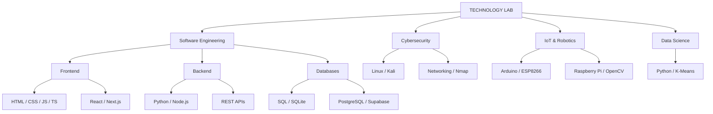
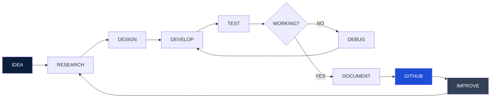
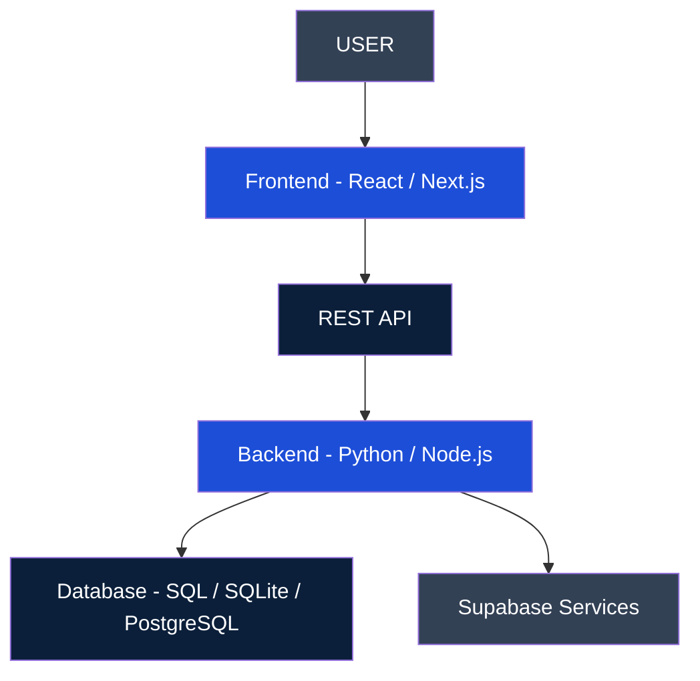
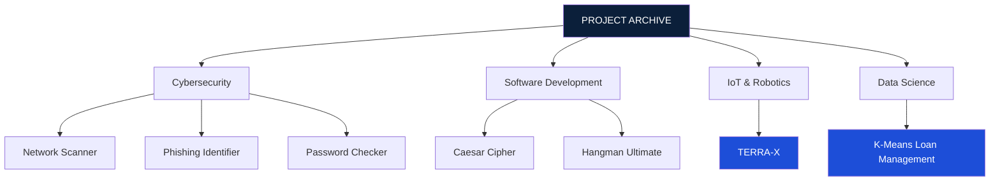
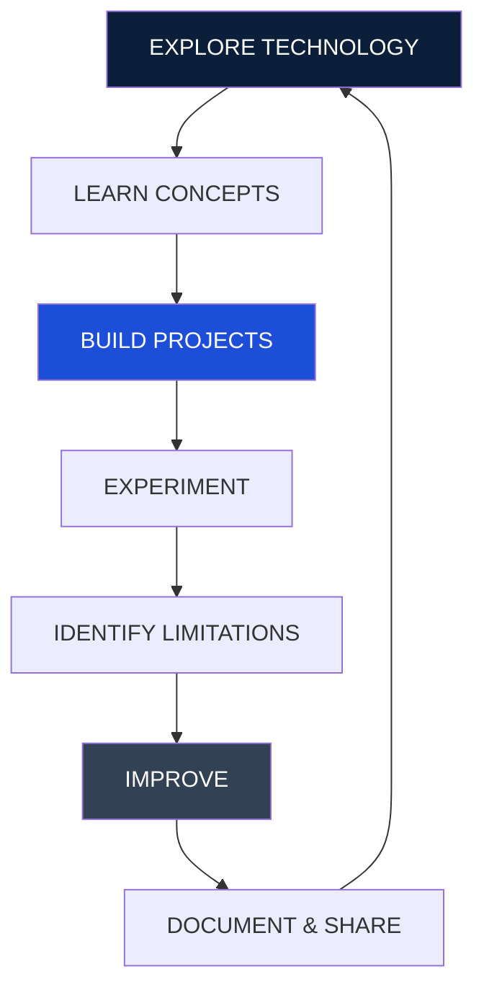

<div align="center">


<br/>


<br/><br/>

[](https://github.com/HARSHA-TKD)
[](https://github.com/HARSHA-TKD?tab=repositories)

</div>

---

<div align="center">

### ⌘ NAVIGATION

[PROFILE](#-01--system-profile) •
[ARSENAL](#-02--technical-arsenal) •
[ECOSYSTEM](#-03--technology-ecosystem) •
[PROJECTS](#-04--project-database) •
[HARDWARE](#-05--hardware-lab) •
[ARCHITECTURE](#-06--system-architecture) •
[STATS](#-07--github-analytics) •
[MISSION](#-08--current-objectives)

</div>

---

## `01` // SYSTEM PROFILE

```bash
┌──[ HARSHA-TKD@github ]
└─$ whoami

> Identity       : Anonymous Developer
> Classification : Technology Enthusiast
> Focus          : Cybersecurity & Development
> Domains        : Full Stack / IoT / Data Science
> Environment   : Linux / Windows
> Hardware      : Embedded Systems & Robotics
> Philosophy    : Learn. Build. Experiment.
> Status        : Continuously Evolving
```

An independent technology enthusiast exploring the intersection of cybersecurity, software engineering, IoT, robotics and data science.

Interested in understanding how systems work, developing practical applications, experimenting with hardware and exploring the engineering behind modern technologies.

**Not just learning technology. Exploring what can be built with it.**

---

## `02` // TECHNICAL ARSENAL

<details open>
<summary><b>01 / Programming Languages</b></summary>
<br/>


</details>

<details open>
<summary><b>02 / Frontend Engineering</b></summary>
<br/>


</details>

<details open>
<summary><b>03 / Backend Engineering & APIs</b></summary>
<br/>


</details>

<details open>
<summary><b>04 / Databases & Storage</b></summary>
<br/>


</details>

<details open>
<summary><b>05 / Cybersecurity & Networking</b></summary>
<br/>


</details>

<details open>
<summary><b>06 / IoT, Embedded Systems & Robotics</b></summary>
<br/>


</details>

<details open>
<summary><b>07 / Data Science & Machine Learning</b></summary>
<br/>


</details>

<details open>
<summary><b>08 / DevOps, Cloud & Developer Tools</b></summary>
<br/>


</details>

---

## `03` // TECHNOLOGY ECOSYSTEM



---

## `04` // PROJECT DATABASE

<div align="center">


</div>

### ◈ SOFTWARE & CYBERSECURITY

<details open>
<summary><b>01. Network Scan Report Generator</b></summary>

Python-based utility using Nmap to perform network scans and generate structured scan reports.

`Python` `Nmap` `Networking`

</details>

<details>
<summary><b>02. Phishing Email Identifier</b></summary>

A Python application that examines email indicators to identify potentially suspicious messages.

`Python` `Email Security`

</details>

<details>
<summary><b>03. Password Strength Checker</b></summary>

Evaluates password characteristics and provides strength feedback.

`Python` `Security`

</details>

<details>
<summary><b>04. Caesar Cipher Tool</b></summary>

Command-line encryption and decryption utility with cipher operations.

`Python` `Cryptography Fundamentals`

</details>

<details>
<summary><b>05. Hangman Ultimate</b></summary>

Interactive terminal-based Hangman game with game logic and scoring functionality.

`Python` `CLI`

</details>

### ◈ DATA SCIENCE & MACHINE LEARNING

<details>
<summary><b>06. K-Means Clustering — Loan Management</b></summary>

An exploratory data project applying K-Means clustering in a loan management context to investigate patterns and groupings within data.

`Python` `K-Means` `Data Analysis`

</details>

### ◈ IoT & HARDWARE ENGINEERING

<details>
<summary><b>07. TERRA-X — IoT & Robotics Prototype</b></summary>

An experimental hardware project integrating microcontrollers, sensors, wireless control and computer vision.

**Hardware & technologies:**

- ESP8266
- Arduino Uno
- Raspberry Pi 3
- DHT11 temperature and humidity sensor
- Ultrasonic sensor
- Servo-based camera system
- OpenCV and live video
- Wireless mobile control

`IoT` `Embedded Systems` `Robotics` `Computer Vision`

</details>

<div align="center">

<a href="https://github.com/HARSHA-TKD?tab=repositories">

</a>

</div>

---

## `05` // HARDWARE LAB

<div align="center">


</div>

| Platform | Exploration |
|:---|:---|
| Arduino Uno | Microcontrollers |
| Raspberry Pi | Single-board computing |
| ESP8266 | Wireless IoT |
| DHT11 | Environmental sensing |
| Ultrasonic Sensor | Distance sensing |
| Servo Motors | Hardware control |
| OpenCV | Computer vision |

---

## `06` // SYSTEM ARCHITECTURE

### A. Project Development Lifecycle



### B. Full-Stack Application Architecture



### C. Project Classification



### D. Learning & Exploration Cycle



---

## `07` // GITHUB ANALYTICS

<div align="center">


<br/><br/>


</div>

---

## `08` // CONTRIBUTION MONITOR

<div align="center">


</div>

---

## `09` // CURRENT OBJECTIVES

- [x] Explore Python development
- [x] Experiment with Linux and Kali Linux
- [x] Build practical Python applications
- [x] Explore IoT and embedded systems
- [ ] Advance networking knowledge
- [ ] Explore penetration testing methodology
- [ ] Develop more IoT prototypes
- [ ] Explore full-stack application development
- [ ] Explore SQL and database management
- [ ] Explore machine learning applications
- [ ] Participate in CTF challenges
- [ ] Build advanced cybersecurity tools

---

<div align="center">

## `SYSTEM MESSAGE`

### BUILD. EXPERIMENT. SECURE. INNOVATE.


<br/><br/>


</div>
