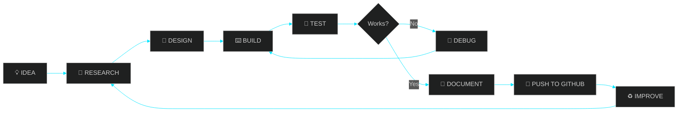
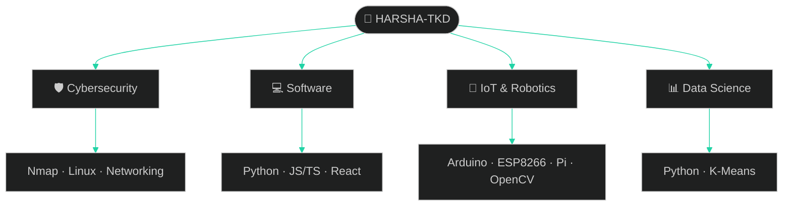

<div align="center">


<br/>


<br/><br/>

[](https://github.com/HARSHA-TKD)
[](https://github.com/HARSHA-TKD?tab=repositories)


</div>

---

<div align="center">

**[PROFILE](#01--system-profile)** · **[ARSENAL](#02--technical-arsenal)** · **[PROJECTS](#03--featured-projects)** · **[HARDWARE](#04--hardware-lab)** · **[WORKFLOW](#05--how-i-build)** · **[STATS](#06--github-analytics)** · **[ROADMAP](#07--roadmap)**

</div>

---

## 01 // System Profile

```bash
┌──[ harsha-tkd@github ]─[~]
└─$ whoami

  identity     →  Anonymous Developer
  focus        →  Cybersecurity & Software Development
  domains      →  Full Stack · IoT · Data Science · Robotics
  environment  →  Linux (Kali) / Windows
  philosophy   →  Learn. Build. Experiment.
  status       →  ● online · continuously evolving
```

I'm an independent builder working at the intersection of **cybersecurity**, **software engineering**, **IoT**, and **data science**. I like understanding how systems really work, then turning that into practical tools and hardware prototypes.

> **Not just learning technology. Exploring what can be built with it.**

---

## 02 // Technical Arsenal

<div align="center">

### `LANGUAGES`


### `WEB & BACKEND`


### `DATABASES`


### `SECURITY & SYSTEMS`


### `HARDWARE & VISION`


### `TOOLS & DEVOPS`


<br/>


</div>

---

## 03 // Featured Projects

### 🛡️ Cybersecurity & Software

| Project | What it does | Stack |
|:--|:--|:--|
| **Network Scan Report Generator** | Runs Nmap scans and produces structured, readable reports | `Python` `Nmap` |
| **Phishing Email Identifier** | Examines email indicators to flag suspicious messages | `Python` |
| **Password Strength Checker** | Evaluates password characteristics and gives feedback | `Python` |
| **Caesar Cipher Tool** | CLI encryption/decryption with cipher operations | `Python` |
| **Hangman Ultimate** | Terminal game with game logic and scoring | `Python` |

### 📊 Data Science

| Project | What it does | Stack |
|:--|:--|:--|
| **K-Means Clustering: Loan Management** | Explores patterns and groupings in loan data using clustering | `Python` `Scikit-Learn` |

### 🤖 Flagship: TERRA-X

<table>
<tr>
<td width="62%" valign="top">

**An experimental IoT & robotics prototype** combining microcontrollers, sensors, wireless control, and computer vision into one platform.

- Servo-based camera system with live video
- OpenCV-powered computer vision
- Environmental sensing (temperature and humidity)
- Ultrasonic distance sensing
- Wireless control from a mobile device

`IoT` `Embedded` `Robotics` `Computer Vision`

</td>
<td width="38%" valign="top">

**Hardware**

- ESP8266
- Arduino Uno
- Raspberry Pi 3
- DHT11 sensor
- Ultrasonic sensor
- Servo motors

</td>
</tr>
</table>

<div align="center">

[](https://github.com/HARSHA-TKD?tab=repositories)

</div>

---

## 04 // Hardware Lab

<div align="center">


</div>

| Platform | Role |
|:--|:--|
| Arduino Uno | Microcontroller control |
| Raspberry Pi 3 | Single-board computing and vision |
| ESP8266 | Wireless IoT connectivity |
| DHT11 | Temperature and humidity sensing |
| Ultrasonic sensor | Distance sensing |
| Servo motors | Mechanical and camera movement |
| OpenCV | Computer vision |

---

## 05 // How I Build





---

## 06 // GitHub Analytics

<div align="center">


<br/>


<br/>


</div>

---

## 07 // Roadmap

| Status | Goal |
|:--:|:--|
| ✅ | Python application development |
| ✅ | Linux and Kali Linux |
| ✅ | IoT and embedded systems |
| 🔄 | Networking fundamentals → advanced |
| 🔄 | Full-stack application development |
| 🔄 | SQL and database management |
| 🎯 | Penetration testing methodology |
| 🎯 | CTF competitions |
| 🎯 | Advanced cybersecurity tooling |
| 🎯 | More IoT prototypes |
| 🎯 | Applied machine learning |

<sub>✅ done · 🔄 in progress · 🎯 next up</sub>

---

<div align="center">

### `BUILD. EXPERIMENT. SECURE. INNOVATE.`


</div>
